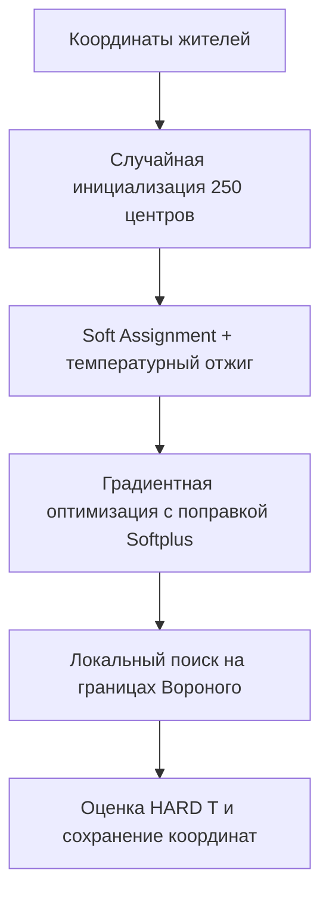

Оптимизация размещения клиник
Решение кейса хакатона Финансового университета и Т1. Требуется разместить 250 клиник для 42 006 жителей Северска так, чтобы минимизировать стоимость расстояния до ближайшей клиники с учётом её пропускной способности.
Для решения использовали геометрическое разбиение пространства на области Вороного, мягкое распределение клиентов (Soft Assignment), градиентную оптимизацию с температурным отжигом, Softplus и дискретный локальный поиск. Вычисления реализованы на PyTorch с поддержкой CUDA.
Результаты
Показатель	Значение
Лучший HARD T	≈ 0.05557947
Количество жителей	~42 000
Количество клиник	250
Максимальная нагрузка (порог штрафа)	1000
Итоговые координаты клиник сохранены в `final_solution.csv`.
Постановка задачи
Пусть $X={x_1,\ldots,x_N}$ — координаты жителей, а $C={c_1,\ldots,c_K}$ — координаты клиник, где $N=42006$, $K=250$, $x_i,c_k\in\mathbb{R}^2$.
Каждый житель относится к ближайшей клинике:
$$
a_i=\arg\min_{1\leq k\leq K}|x_i-c_k|2,\qquad d_i=|x_i-c{a_i}|_2.
$$
Нагрузка на клинику:
$$
n_k=\sum_{i=1}^{N}\mathbf{1}[a_i=k].
$$
Целевая функция:
$$
T(C)=\frac{1}{N}\sum_{i=1}^{N}\left(\alpha d_i+\beta d_i^2\right)+\gamma\sum_{k=1}^{K}\max(0,n_k-L),
$$
где $\alpha=0.05$, $\beta=0.02$, $\gamma=0.01$, $L=1000$.
Линейный и квадратичный члены определяют стоимость расстояния, причём квадратичный сильнее штрафует удалённых жителей. Второе слагаемое учитывает превышение нагрузки. Порог $L$ задан как штраф в целевой функции, а не как жёсткое ограничение допустимости.
Задача относится к классу задач размещения объектов (facility location). Она близка к евклидовой задаче p-медианы, но отличается нелинейной стоимостью расстояния и штрафом за нагрузку. При переходе жителя из одной области обслуживания в другую нагрузка меняется скачком, поэтому прямой градиентный спуск по всей целевой функции неудобен.
Исходные данные и EDA
В `clinic-data.csv` содержится 42 006 строк и 8 числовых признаков. Пропуски отсутствуют.
Признак	Описание
`x`, `y`	Координаты жителя
`client_age`	Возраст
`clinick_distance`	Признак расстояния до клиники из исходных данных
`density_area`	Плотность населения
`park_distance`	Признак расстояния до парка
`vulnerable_group_density`	Плотность уязвимых групп населения
`social_infrastructure_rating`	Оценка социальной инфраструктуры
Перед оптимизацией исследовали распределение координат и дополнительных признаков:
пространственное распределение жителей с помощью Hexbin и scatter plot;
гистограммы, KDE и boxplot;
коэффициенты асимметрии, описательные статистики и корреляции;
проверка пропусков и поиск выбросов методом межквартильного размаха (IQR).
В итоговой оптимизации используются только координаты `x` и `y`: остальные признаки изучались в рамках EDA, но не входят в целевую функцию. Координаты не нормализуются, чтобы не изменить исходную геометрию и масштаб расстояний.
Методы решения

1. Геометрическое разбиение пространства: диаграммы Вороного
При фиксированных координатах клиник плоскость разбивается на области Вороного. Каждая область содержит точки, для которых соответствующая клиника является ближайшей:
$$
V_k={x\in\mathbb{R}^2:|x-c_k|_2\leq|x-c_j|_2,\ \forall j\ne k}.
$$
Это позволяет вычислять нагрузку клиник без решения отдельной задачи назначения. Перемещение центра изменяет границы областей и распределение клиентов между клиниками.
В коде области Вороного задаются неявно, через матрицу евклидовых расстояний `torch.cdist` и выбор ближайшего центра `torch.argmin`. Отдельное построение полигонов Вороного не требуется. Границы используются на заключительном этапе оптимизации.
2. Случайная инициализация центров (`init_centers`)
Начальные координаты 250 клиник выбираются из координат жителей без повторного выбора одной и той же строки (`torch.randperm`). Это позволяет начать оптимизацию с центров, расположенных внутри населённых областей.
Для NumPy и PyTorch фиксируется `seed = 42`.
3. Soft Assignment и температурный отжиг (`stage_1_5_soft`)
При жёстком назначении клиент принадлежит только ближайшей клинике. Для градиентной оптимизации заменяем такое назначение весами, полученными из Softmax по отрицательным евклидовым расстояниям:
$$
w_{ik}(\tau)=\frac{\exp(-d_{ik}/\tau)}{\sum_{j=1}^{K}\exp(-d_{ij}/\tau)},\qquad d_{ik}=|x_i-c_k|_2.
$$
Мягкая нагрузка клиники равна сумме весов:
$$
\tilde n_k=\sum_{i=1}^{N}w_{ik}.
$$
При высокой температуре клиент влияет на несколько соседних центров. По мере снижения температуры веса концентрируются на ближайшем центре. Используется экспоненциальное расписание отжига (annealing):
$$
\tau_t=\tau_{start}\left(\frac{\tau_{end}}{\tau_{start}}\right)^{t/M},
$$
где $\tau_{start}=0.2$, $\tau_{end}=0.01$, $M=2000$.
Для функции стоимости расстояния $f(d)=\alpha d+\beta d^2$ производная по координатам центра имеет вид:
$$
\nabla_{c_k}f(d_{ik})=\frac{\alpha+2\beta d_{ik}}{d_{ik}}(c_k-x_i).
$$
На каждой итерации вычисляется взвешенное направление обновления:
$$
g_k=\frac{1}{\tilde n_k+\varepsilon}\sum_{i=1}^{N}w_{ik}\frac{\alpha+2\beta d_{ik}}{d_{ik}}(c_k-x_i).
$$
Координаты обновляются одновременно:
$$
c_k\leftarrow c_k-\eta g_k.
$$
Градиент считается аналитически при фиксированных весах текущей итерации. Производные самих весов Softmax не учитываются. По структуре это мягкая итеративная кластеризация с градиентным обновлением центров, а не стандартный K-Means: здесь используется другая функция стоимости.
Параметры этапа: 2000 итераций, шаг $\eta=0.1$, температурный отжиг от 0.2 до 0.01.
4. Учёт нагрузки через Softplus (`stage_2_softplus`)
Штраф за превышение нагрузки содержит негладкую функцию $\max(0,z)$. Для мягкой поправки используется её гладкая аппроксимация:
$$
\operatorname{softplus}(z)=\log(1+e^z),\qquad z=\tilde n_k-L.
$$
На этом этапе Soft Assignment рассчитывается с фиксированной температурой 1. Для каждого центра сначала вычисляется ненормированное взвешенное направление:
$$
h_k=\sum_{i=1}^{N}w_{ik}\frac{\alpha+2\beta d_{ik}}{d_{ik}+\varepsilon}(c_k-x_i).
$$
В реализации поправка к обновлению центра задаётся следующим образом:
$$
c_k\leftarrow c_k-\eta\frac{\left[1+\gamma\operatorname{softplus}(\tilde n_k-L)\right]h_k}{\tilde n_k+\varepsilon}.
$$
Таким образом, величина превышения мягкой нагрузки влияет на размер градиентного шага. Это эвристическая поправка, а не полный градиент штрафа по координатам центров: производные нагрузки по координатам не вычисляются.
Параметры этапа: 1000 итераций, шаг $\eta=0.05$.
5. Дискретный локальный поиск на границах Вороного (`stage_6pp`)
После градиентных этапов возвращаемся к исходному жёсткому распределению (Hard Assignment). Основной интерес представляют жители, находящиеся вблизи границ между областями обслуживания: даже небольшой сдвиг клиник может изменить их принадлежность.
Для каждого жителя через `torch.topk` определяются расстояния до двух ближайших клиник $d_{i,(1)}$ и $d_{i,(2)}$. Житель считается пограничным, если:
$$
d_{i,(2)}-d_{i,(1)}<\varepsilon_b,\qquad \varepsilon_b=10^{-3}.
$$
Далее:
Формируем множество клиник, которые являются первой или второй ближайшей клиникой для пограничных жителей.
Пробуем одновременно сдвинуть эти центры на $\delta=5\cdot10^{-5}$ по одной из координат: $-x$, $+x$, $-y$, $+y$.
Для каждого кандидата пересчитываем исходную целевую функцию с жёстким назначением.
Принимаем первый сдвиг, который строго уменьшает $T(C)$ (first-improvement local search).
Повторяем поиск до отсутствия улучшений, исчерпания 500 итераций или уменьшения числа пограничных жителей ниже 10.
Этот этап не использует производные и работает непосредственно с исходной метрикой. В отличие от градиентных этапов, каждое принятое обновление гарантирует уменьшение вычисленного значения `HARD T`. Глобальная оптимальность решения при этом не гарантируется.
Параметры оптимизации
Этап	Метод	Параметры
Stage 0	Случайная инициализация	250 центров, seed = 42
Stage 1.5	Soft Assignment, температурный отжиг, градиентное обновление	2000 итераций, lr = 0.1, tau: 0.2 → 0.01
Stage 2	Градиентное обновление с поправкой Softplus	1000 итераций, lr = 0.05, tau = 1
Stage 6++	Дискретный поиск по границам Вороного	до 500 итераций, delta = 0.00005, boundary_eps = 0.001
Реализация и вычислительная сложность
Основные вычисления выполняются над матрицей расстояний размером $N\times K$ (`42 006 × 250`), то есть 10 501 500 расстояний. Одна такая матрица в `float32` занимает около 40 МиБ; фактическое потребление памяти выше из-за промежуточных тензоров.
`torch.cdist` — расчёт попарных евклидовых расстояний;
`torch.softmax` — мягкие веса принадлежности;
`torch.argmin` и `torch.bincount` — жёсткое назначение и подсчёт нагрузки;
`torch.nn.functional.softplus` — гладкая поправка на превышение нагрузки;
`torch.topk` — поиск двух ближайших центров;
`torch.no_grad` — вычисление метрики и локальный поиск без построения графа автоматического дифференцирования.
Вычисление расстояний и мягких весов требует $O(NK)$ времени и памяти при фиксированной размерности координат. В градиентных этапах обновления каждого центра рассчитываются в цикле. Локальный поиск дополнительно пересчитывает метрику для пробных сдвигов.
Стек
Python, PyTorch, CUDA, NumPy, Pandas, SciPy, scikit-learn, Matplotlib, Seaborn, Jupyter Notebook.
Запуск
```bash
git clone https://github.com/denispvx/hackathon_FU-T1.git
cd hackathon_FU-T1
pip install notebook torch numpy pandas scipy scikit-learn matplotlib seaborn
jupyter notebook notebook.ipynb
```
Выполнить ячейки ноутбука последовательно. При наличии CUDA вычисления выполняются на GPU, иначе на CPU. Для GPU необходимо установить совместимую с драйвером сборку PyTorch. При повторном запуске `final_solution.csv` будет перезаписан.
Структура репозитория
```text
.
├── clinic-data.csv       # Координаты и характеристики жителей
├── notebook.ipynb        # EDA, математическая модель и оптимизация
├── final_solution.csv    # Координаты 250 клиник
└── README.md
```
